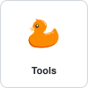

# PROMPT.md: maintaining the organization tiles

Instructions for an AI assistant (or a human) updating the "duck tiles" shown on the Gander GitHub profiles.
Read it fully before touching anything.

## What the tiles are

Every Gander profile shows the same grid of 18 square tiles (a duck or logo with a name below), each linking to an organization:
`Gander`, `Tools`, `Pages`, `Labs`, `Actions`, `APIs`, `Data`, `MCP`, `n8n`, `Schemas`, `Settings`, `Skills`, `Templates`, `Scripts`, `Containers`, `Examples`, `Archive`, `Diff Voyager` (in this order).

## Where things live

| What | Where |
| --- | --- |
| Tile images (source of truth) | `gander/gander` -> `assets/tiles/<key>.svg`, served from `https://raw.githubusercontent.com/gander/gander/master/assets/tiles/<key>.svg` |
| Duck per organization | `gander-<org>/.github` -> `assets/duck.svg` (`gander` itself: `gander/gander` -> `assets/duck.svg`) |
| Duck color library | `~/Obrazy/Duck SVG/duck-<color>.svg` (use a color no other organization uses) |
| Diff Voyager logo (light and dark) | `diff-voyager/.github` -> `assets/diff-voyager-{light,dark}.svg` (only logotypes live there, no ducks) |
| Grid in the user profile | `gander/gander` -> `README.md` |
| Grid in each organization profile | `gander-<org>/.github` -> `profile/README.md` (all 16 organizations) |

Tile keys: the organization name without `gander-` (`tools`, `n8n`, ...), `gander` for the user, `diff-voyager` for Diff Voyager.
The `diff-voyager` organization is outside the `gander-*` wildcard on purpose; it is an explicit exception, and nothing else in it may be touched.

## How to build a tile

One SVG per tile, `viewBox="0 0 100 100"` (square), self-contained:

- a rounded border: `<rect class="b" x=".5" y=".5" width="99" height="99" rx="8"/>`
- the duck or logo as `<image x="26" y="14" width="48" height="48" xlink:href="data:image/svg+xml;base64,...">`, embedded as a data URI (an SVG loaded through `` cannot fetch external files) and declared with `xmlns:xlink="http://www.w3.org/1999/xlink"`
- the name: `<text x="50" y="84" text-anchor="middle">`, font `600 11px -apple-system,'Segoe UI',Helvetica,Arial,sans-serif`; fill `#24292f`, border stroke `#d0d7de`
- dark mode inside the SVG: `@media (prefers-color-scheme:dark){text{fill:#e6edf3}.b{stroke:#30363d}}`
- `<title>` and `aria-label` set to the name
- Diff Voyager has two `<image>` elements (class `l` for the light logo, class `d` for the dark one) and CSS that shows `.l` by default and `.d` in dark mode (`.d{display:none}` by default, swapped in the media query)

Keep every tile identical except for the image and the name, so scales match.

## How to build the grid

GitHub strips `style` and CSS from READMEs, so layout relies on plain HTML only. The block is:

```html
<div align="center">
<a href="https://github.com/gander-tools"></a>
...one <a></a> per line, same order as above...
</div>
```

- Fixed `width="100" height="100"` (do not use percentages): tiles wrap to the next row instead of scaling.
- One tile per line, so whitespace between them lets the browser break the row.
- Links: organizations -> `https://github.com/<owner>`; Diff Voyager -> `https://github.com/diff-voyager`.
- In every `gander-<org>/.github/profile/README.md` the very first line is `**[Gander <Name>](https://gander-<org>.github.io/)**` followed by a blank line, then the block. `<Name>` is the capitalized org name (`Tools`, `n8n`). The user profile README has the block only.

## Workflow

1. Generate or update the tile SVGs (a small Python script with `base64` is enough; run it with `python3 -I`).
2. Check them in Chrome headless in light mode and, by temporarily replacing `@media (prefers-color-scheme:dark)` with `@media all` in a copy, in dark mode.
3. `gander/gander` is protected by a ruleset (pull request and Socket Security checks, no bypass). Push a branch, open a PR, wait for the checks and merge it with a **merge commit**. Never squash or rebase (it destroys GPG signatures).
4. **Only after the tiles are on `master` and their raw URLs return HTTP 200**, update the READMEs. Doing it earlier leaves every profile with broken images.
5. Update `gander-<org>/.github` repos directly on `main` (pull with `--ff-only` first, no PR), then compare the local and remote HEAD SHA.
6. Commit messages: English, Conventional Commits (`docs(readme): ...`, `feat(assets): ...`), no attribution lines.

## Adding a new organization

1. Pick an unused color from the duck library and create `gander-<org>/.github` (public, description `Default community health files for gander-<org>`) with `LICENSE`, `.gitignore`, `assets/duck.svg` and `profile/README.md` copied from an existing organization.
2. Add its tile to `assets/tiles/`, merge via PR (workflow step 3).
3. Insert it into the grid in the agreed order and refresh the block in `gander/gander/README.md` and in all `.github/profile/README.md` files, so the tile count and order stay identical everywhere.
4. Create its `gander-<org>.github.io` Pages site if it does not exist yet.
